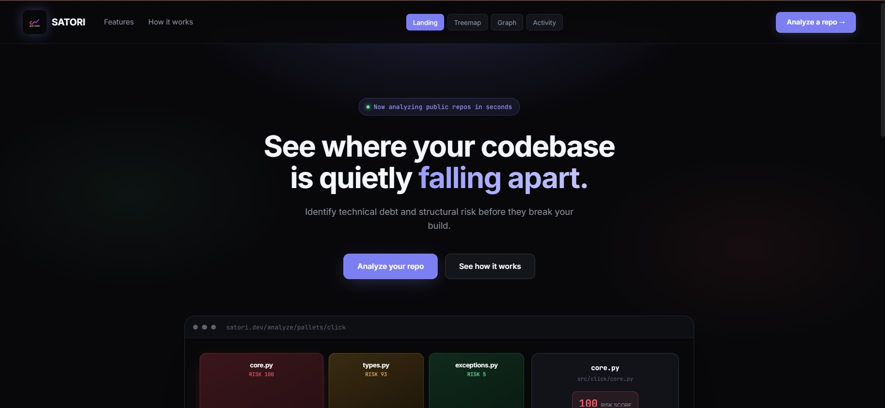
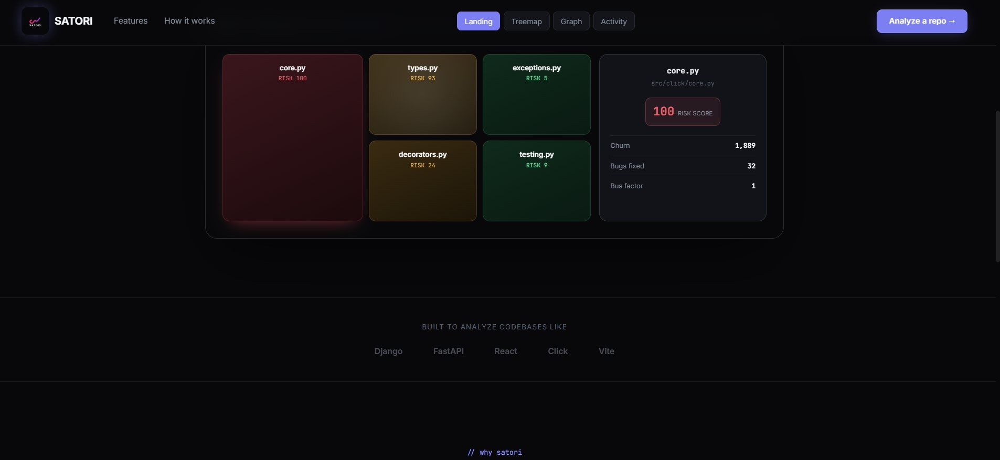
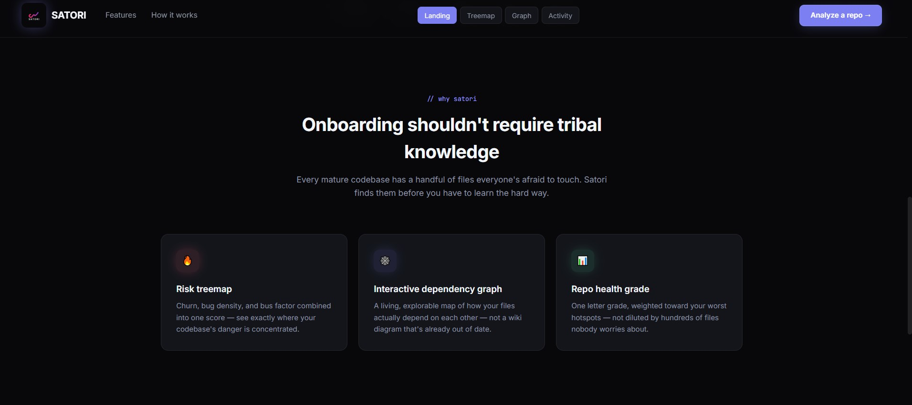
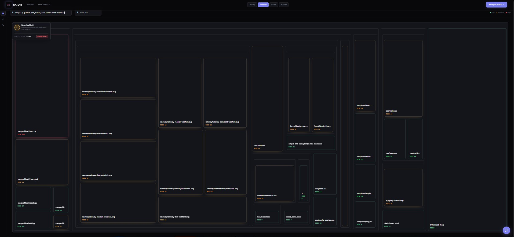
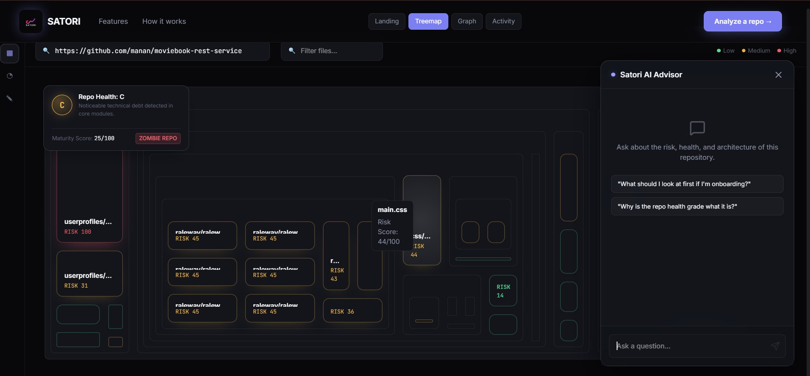
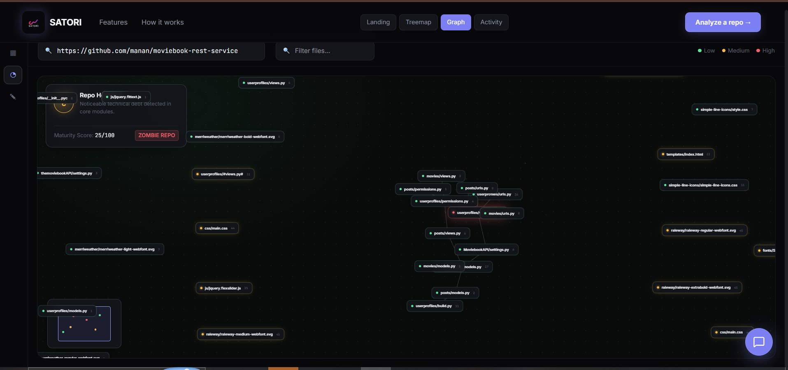
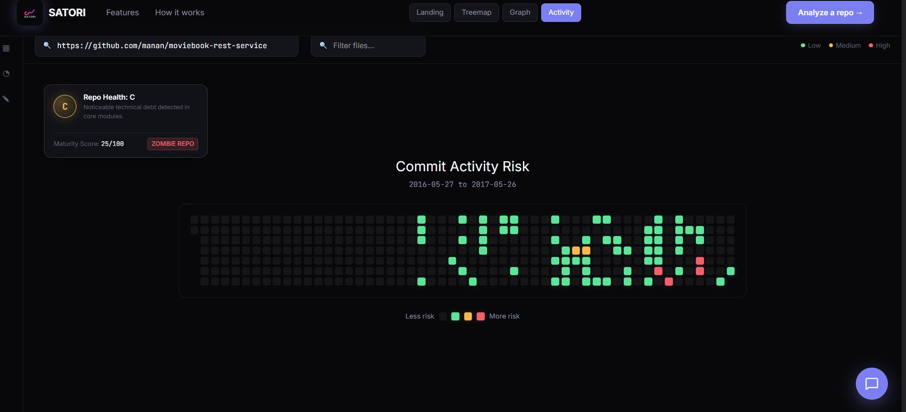

<div align="center">


# Satori

**See where your codebase is quietly falling apart.**

Satori turns raw git history into a living map of risk — the files nobody understands, the bugs waiting to happen, and the architecture holding everything together.

[](https://www.python.org/)
[](https://fastapi.tiangolo.com/)
[](https://react.dev/)
[](https://www.typescriptlang.org/)
[](https://www.mongodb.com/atlas)
[](https://redis.io/)
[](https://ai.google.dev/)
[](./LICENSE)

[**Live Demo**](#) · [Features](#features) · [Architecture](#architecture) · [Local Setup](#local-setup)

</div>

---

## What is Satori?

New developers joining a codebase have no reliable way to know which files are fragile, which ones only one person understands, and which parts are quietly accumulating risk. That knowledge normally lives in senior engineers' heads and gets passed down slowly, if at all.

Satori mines a repository's real git history and turns it into two explorable views — a risk-colored treemap and an interactive dependency graph — so that risk is something you can *see*, not something you have to be told about in a hallway conversation.

Point it at any public GitHub repository. No login required.

---

## Screenshots

<div align="center">

<br /><br />

<br /><br />

<br /><br />

<br /><br />

<br /><br />

<br /><br />

</div>

---

## Features

**🔥 Risk Heatmap**
Every file sized and colored by a computed risk score — churn, bug density, and bus factor combined into one number, so danger is visible at a glance instead of buried in commit logs.

**🕸️ Interactive Dependency Graph**
A force-directed, explorable map of how your files actually depend on each other. Drag nodes, trace paths, filter by name — the architecture as it really is, not as a stale wiki diagram remembers it.

**📊 Repo Health Grade**
A single A–F grade weighted toward your worst hotspots, using a top-5-average so one catastrophic file can't get diluted into invisibility by hundreds of quiet ones.

**🤖 Vibe Score**
A per-file heuristic estimating AI-assistance likelihood from comment density, commit message entropy, and commit velocity — presented honestly as a confidence signal, never a verdict.

**📅 Commit Activity Calendar**
A GitHub-style contribution calendar, but each day is colored by the *risk* of that day's commits, not just how many there were.

**🧭 Project Maturity & Zombie Repo Detection**
Scores a repo on README presence, CI/CD, test coverage, and recency of activity — and flags repositories that are both stagnant and dangerously concentrated in a single contributor.

**💬 Risk-Aware AI Chat**
Ask questions in plain language and get answers grounded in Satori's own computed metrics and real source code — not a generic chatbot guessing at your repo.

**🛠️ Smart Per-File Recommendations**
Deterministic, rule-based suggestions for high-risk files — no LLM guesswork, just clear next steps derived from the exact metrics driving that file's score.

**📤 CSV Export**
One click to get the full analysis — every file, every metric — into a spreadsheet.

---

## Architecture

```
Client (React)
   │  submits repo URL
   ▼
API server (FastAPI) ──▶ Job queue (Redis + RQ) ──▶ Analysis worker
                                                        │  clone → mine (pydriller)
                                                        │  parse (tree-sitter)
                                                        │  score → persist
                                                        ▼
                                                  MongoDB Atlas
   ▲                                                    │
   └──────────────── poll / fetch graph ────────────────┘
```

Analysis runs asynchronously so the API stays responsive regardless of repository size. Repeated requests for an unchanged repository are served from cache rather than re-cloned and re-mined.

### Tech Stack

| Layer | Technology |
|---|---|
| **Backend** | Python, FastAPI, `pydriller`, `tree-sitter` |
| **Async Processing** | Redis, RQ |
| **Database** | MongoDB Atlas |
| **AI** | Google Gemini 1.5 Flash |
| **Frontend** | React, Vite, TypeScript |
| **Visualization** | `react-force-graph-2d`, Nivo, custom Canvas/SVG |
| **Styling** | Vanilla CSS, custom design system |

---

## Folder Structure

```text
Satori/
├── backend/                  # FastAPI Python backend
│   ├── api/                  # REST API routes and models
│   ├── core/                 # Git mining, AST parsing, and risk scoring logic
│   ├── db/                   # MongoDB client
│   └── worker/               # Asynchronous RQ worker tasks
├── frontend/                 # React + Vite frontend
│   ├── src/
│   │   ├── api/              # API client for backend communication
│   │   ├── components/       # UI components (DependencyGraph, RiskTreemap, Chat)
│   │   └── utils/            # Data transformation utilities
│   └── public/               # Static assets
└── Readme.md
```

---

## Local Setup

### Prerequisites
- Python 3.12+
- Node.js 18+
- A MongoDB Atlas connection string (free tier is sufficient)
- A Redis instance (Upstash free tier works well)
- A free Google Gemini API key

### Backend

```bash
cd backend
python -m venv venv
source venv/bin/activate        # Windows: venv\Scripts\activate
pip install -r requirements.txt
cp .env.example .env            # fill in MONGO_URI, REDIS_URL, GOOGLE_API_KEY
uvicorn api.main:app --reload
```

In a second terminal, start the worker:

```bash
cd backend
python -m worker.run_worker
```

### Frontend

```bash
cd frontend
npm install
cp .env.example .env            # set VITE_API_URL=http://localhost:8000
npm run dev
```

Visit `http://localhost:5173`, paste a public GitHub repository URL, and analyze.

---

## Honest Limitations

- **Vibe Score is a heuristic, not a certainty.** There's no reliable ground truth for "AI-written code" — disciplined, well-documented human work can score similarly to AI-assisted work. It's presented as a signal worth investigating, never a verdict.
- **The AI Chat sees the top 20 riskiest files**, capped at 1,000 lines each, to stay within free-tier token limits. Questions about files outside that set will be answered honestly as out of scope, not guessed at.
- **Analysis reflects the last 12 months of activity** by default to surface current, actionable risk. If a repository has been dormant for over a year, Satori automatically falls back to analyzing the full history to ensure the analysis still succeeds.

---

## License

MIT — see [LICENSE](./LICENSE) for details.

<div align="center">
<sub>Built for developers who inherit other people's code.</sub>
<br />
<sub>Created by Raghav Dhingra</sub>
</div>